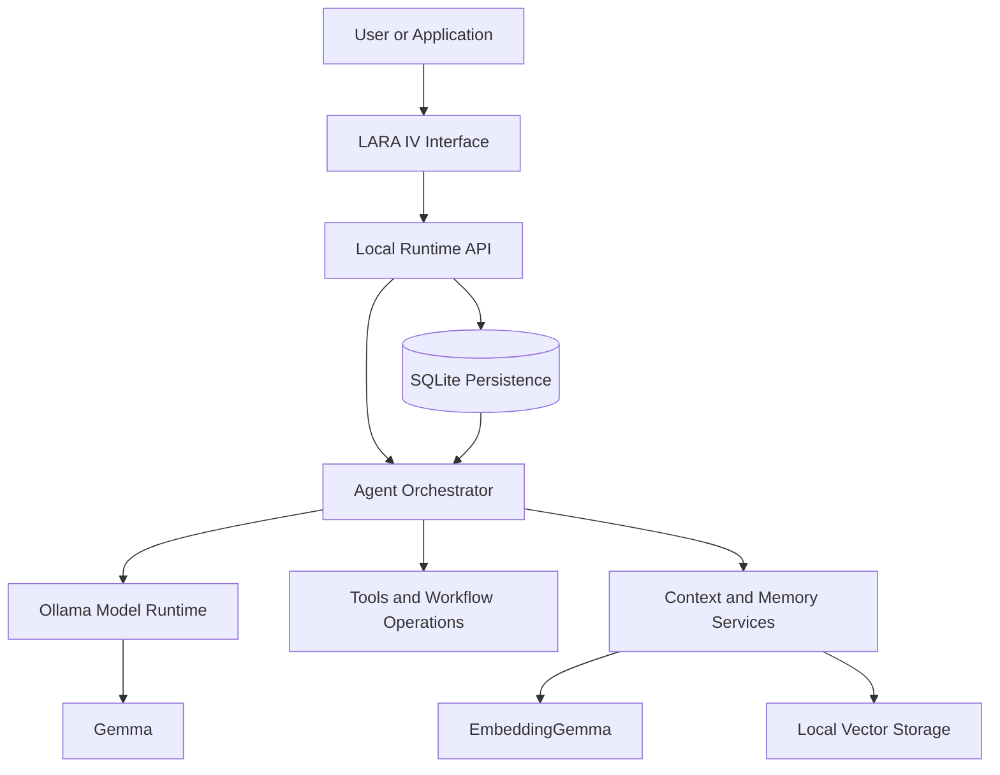

# LARA IV
### Local-First Agentic Runtime Accelerator

**A local-first runtime for orchestrating AI agents, language models, persistent memory, tools, and intelligent workflows.**

LARA IV is a local-first agentic runtime designed to bring AI inference, multi-agent orchestration, contextual memory, and workflow execution into one integrated environment. It combines locally hosted language models with persistent state, semantic retrieval, and structured agent collaboration to help developers build and operate AI-powered workflows with greater control over their data and execution environment.

Rather than treating AI as a collection of disconnected chat interfaces, LARA IV focuses on the runtime layer: connecting models, context, agents, and actions into a coordinated system.

**Repository:** [Ashwath-Raj/LARA-III](https://github.com/Ashwath-Raj/LARA-III)

---

## Overview

Modern AI applications often depend on remote inference services, fragmented context, and disconnected tools. LARA IV explores a different approach: a local-first runtime in which models, memory, agent workflows, and application state work together within a unified system.

The project is built around four principles:

- **Local-first execution:** Run supported language models locally through Ollama.
- **Agentic orchestration:** Structure AI work into coordinated roles, workflows, and review stages.
- **Persistent context:** Connect conversations and knowledge with local storage and semantic retrieval.
- **Controlled tool use:** Integrate AI workflows with application capabilities while maintaining explicit execution boundaries.

LARA IV is both an AI runtime foundation and an environment for developing, testing, and operating local agentic systems.

## Core Capabilities

### Local Model Runtime

Integrate locally hosted language models through Ollama for inference without requiring a remote model API for supported workflows.

The runtime can be configured around available models, hardware resources, and the needs of individual tasks.

### Multi-Agent Orchestration

LARA IV includes a structured four-role AI Loop:

| Agent role | Responsibility |
|---|---|
| **Blue Team** | Proposes an approach or solution. |
| **Red Team** | Challenges assumptions and identifies weaknesses. |
| **Judge** | Synthesizes the arguments into a decision. |
| **Unbiased Reviewer** | Audits the reasoning and final result. |

This structure provides a foundation for adversarial review, multi-perspective reasoning, and more deliberate AI-assisted decision-making.

Actual execution depends on the configured model provider and successful completion of each workflow stage.

### Persistent Memory and Semantic Retrieval

Support contextual AI workflows with persisted conversations, knowledge records, embeddings, and semantic retrieval.

The intended workflow is to make relevant information available beyond an individual prompt, subject to memory configuration and successful indexing.

Conversation history and long-term memory are separate capabilities: saving a conversation does not necessarily mean its contents have been indexed for future retrieval.

### Agent Workflows and Tools

Connect agent reasoning to application operations and supported tools. The application includes task management, project organization, reminders, calendar events, and related workflow interfaces that can support broader agentic use cases.

Tool execution and desktop automation must respect the configured permissions and runtime environment.

### Runtime Observability and Persistence

Use persistent application records and execution state to inspect conversations, tasks, agent sessions, and workflow results where supported by the current implementation.

SQLite provides the application's core persistence layer, while local model inference and knowledge retrieval use their respective configured services.

---

## Architecture



The high-level architecture separates the interface, application API, agent orchestration, model inference, persistence, and memory services.

The diagram represents the intended component relationships; specific runtime capabilities depend on the implemented integrations and configuration.

## Technology Stack

| Component | Technology |
|---|---|
| Frontend | React, TypeScript, Vite |
| Backend API | Python, FastAPI |
| Persistent application data | SQLite |
| Local inference | Ollama |
| Chat model configuration | Gemma 4 E2B, quantized |
| Embeddings | EmbeddingGemma |
| Semantic retrieval | Local embedding and vector-storage services |
| Automated testing | pytest and frontend build/lint tooling |

## Local Models

The current local setup uses these Ollama models:

| Model | Purpose | Identifier |
|---|---|---|
| Gemma 4 E2B, instruction-tuned and quantized | Local chat and inference | `gemma4:e2b-it-q4_K_M` |
| EmbeddingGemma | Text embeddings for semantic retrieval | `embeddinggemma:latest` |

Install the models with:

```bash
ollama pull gemma4:e2b-it-q4_K_M
ollama pull embeddinggemma
```

Check installed models:

```bash
ollama list
```

The models run through Ollama. Availability of a model does not, by itself, guarantee that every agent workflow, memory operation, or tool integration is fully operational.

## Getting Started

### Prerequisites

- Ubuntu or a compatible Linux environment.
- Python compatible with the backend's dependency configuration.
- Node.js and npm compatible with the frontend.
- Ollama.
- Sufficient RAM, storage, and compute resources for the selected models.

Check the installed tools:

```bash
python3 --version
node --version
npm --version
ollama --version
```

### Installation

Clone the repository:

```bash
git clone https://github.com/Ashwath-Raj/LARA-III.git
cd LARA-III
```

Set up the Python environment:

```bash
python3 -m venv .venv
source .venv/bin/activate
python -m pip install --upgrade pip
```

Install backend dependencies using the dependency manifest provided by the repository.

Install frontend dependencies:

```bash
cd frontend
npm install
cd ..
```

If the repository contains a `package-lock.json`, use `npm ci` for reproducible frontend dependency installation.

Start Ollama and ensure the required models are installed. Review the environment examples and configuration files before starting the application.

### Run Locally

From the repository root, use the local development launcher:

```bash
./scripts/start-lara-local.sh
```

Open:

**http://127.0.0.1:5173**

The expected development architecture uses a frontend on port `5173` and a backend API on `127.0.0.1:8765`, subject to the repository's current configuration.

Use `Ctrl+C` to stop the services.

No public tunnel is required for normal localhost development.

## Demo Environment

LARA IV provides an explicit demo-data seeding workflow for developing and evaluating the interface with synthetic records.

An example command from the current development setup is:

```bash
.venv/bin/python -m ubuntu_agent \
  --db "${XDG_DATA_HOME:-$HOME/.local/share}/ubuntu-agent/lara-demo.sqlite3" \
  seed-demo --index-knowledge
```

Check the repository's current CLI and startup configuration before running the command.

Demo records may include projects, tasks, conversations, reminders, calendar events, knowledge notes, and illustrative AI Loop sessions.

**Synthetic demo records must not be confused with actual user activity or live model-generated outputs.** Seed into the intended demo database rather than a database containing important user data.

## Development and Testing

Run the backend tests:

```bash
.venv/bin/python -m pytest -q
```

Build the frontend and run lint checks:

```bash
cd frontend
npm run build
npm run lint
```

Useful areas for regression testing include:

- Agent Loop execution and output persistence.
- Conversation and task persistence.
- Task and sticky-note create/edit flows.
- Database migrations and integrity.
- Memory indexing and retrieval.
- Model availability and provider errors.
- API authentication, permissions, and local-origin restrictions.

Distinguish synthetic fixture tests from tests that invoke real local models. A successful frontend build does not establish that live inference and every runtime integration are working.

## Project Structure

The intended consolidated repository structure is:

```text
LARA-III/
├── frontend/
│   ├── src/
│   ├── public/
│   └── package.json
├── ubuntu_agent/
│   ├── api.py
│   ├── database.py
│   ├── services.py
│   └── ...
├── scripts/
│   └── start-lara-local.sh
├── tests/
├── README.md
└── .gitignore
```

Use the actual checked-in directory structure as the source of truth; additional modules, migrations, configuration, and test files may exist.

## Privacy and Security

LARA IV is designed around local-first operation, but privacy depends on the entire deployment configuration.

- Bind local development services to loopback interfaces.
- Keep authentication enabled for non-demo deployments.
- Do not commit API keys, credentials, session tokens, or private environment files.
- Exclude local databases, personal backups, model weights, virtual environments, and generated dependencies from Git.
- Treat synthetic demo data separately from personal or production data.
- Respect memory exclusions and configured tool permissions.
- Review external integrations and network requests before describing a workflow as completely offline.

## Roadmap

Potential areas for continued development include:

- More robust agent orchestration, retries, cancellation, and recovery.
- Improved runtime observability and per-agent execution traces.
- More reliable cross-conversation memory and retrieval.
- Better model/provider configuration and health reporting.
- Expanded tool interfaces and explicit approval boundaries.
- End-to-end evaluation of agent workflows using real local inference.
- Deployment hardening and reproducible installation.

These are potential areas for improvement, not claims that every capability is already complete.

## Contributing

Contributions and focused improvements are welcome.

1. Inspect the existing implementation and open issues.
2. Create a feature branch.
3. Keep changes focused and add regression tests.
4. Run relevant backend tests, frontend build, and lint checks.
5. Review changes for secrets, personal data, generated files, and unrelated modifications.
6. Document the actual behavior and known limitations in the pull request.

## License

Check the repository for an existing `LICENSE` file. If the repository has no license, the licensing terms remain undecided; public visibility alone does not grant permission to reuse the project.

---

**LARA IV — Local-First Agentic Runtime Accelerator**

*Local models. Persistent context. Coordinated agents. Controlled execution.*
